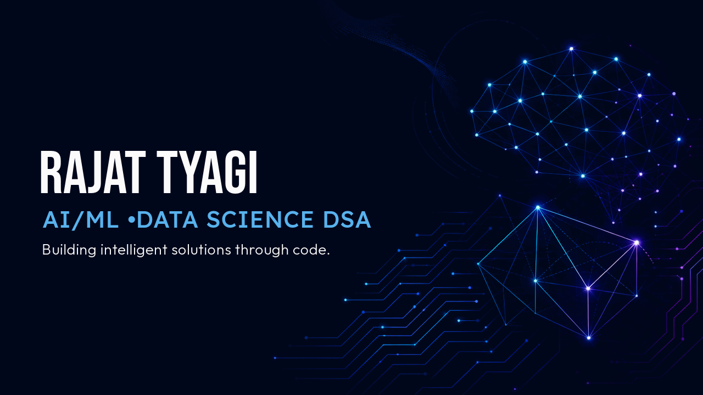

  

 

  Building intelligent solutions through machine learning, data analysis, and software development.

  
  
  
  

---

## 👨‍💻 About Me

I'm a second-year B.Tech Computer Science student specializing in Artificial Intelligence and Machine Learning at **IILM University, Greater Noida**.

I'm interested in understanding how machine learning algorithms work, building data-driven applications, and turning raw data into meaningful insights.

* 🤖 **Focus Areas:** Machine Learning, Data Science, Predictive Analytics
* 🧠 **Currently Learning:** Supervised Learning, Model Evaluation, Deep Learning Fundamentals
* 💻 **Programming:** Python, C, C++, Java
* 📊 **Data Science:** NumPy, Pandas, Matplotlib, Scikit-learn
* 🔬 **Interests:** Algorithm Implementation, Exploratory Data Analysis, Intelligent Applications
* 🤝 **Open To:** Internships, Open-Source Contributions, Technical Collaborations
* 📍 **Location:** Ghaziabad, Uttar Pradesh, India

---

## 🛠️ Technical Skills

### Programming Languages

  
  
  
  

### Data Science & Machine Learning

  
  
  
  
  

### Developer Tools

  
  
  

---

## 🚀 Featured Projects

### 💸 1. SpendSense — Data-Driven Expense Analysis

**Repository:** [SpendSense](https://github.com/tyagirajat154/SpendSense)

A data science project focused on analysing personal expenses, identifying spending patterns, and generating insights that can support better budgeting decisions.

**Key Features**

* Exploratory Data Analysis (EDA) to understand expense distributions and trends.
* Category-wise spending analysis to identify major expense categories.
* Monthly expense trend analysis to observe changes in spending over time.
* Data visualisation to communicate financial patterns through charts and graphs.
* Data preprocessing and feature preparation for analytical modelling.

**Technical Stack:** Python, Pandas, NumPy, Matplotlib, Scikit-learn, Jupyter Notebook

**Analytical Approach**

* **Exploratory Data Analysis:** Examines dataset structure, summary statistics, missing values, and spending distributions.
* **Linear Regression:** Explores relationships between input features and expense amounts to study predictive patterns.
* **Time-Series Analysis:** Prophet can be used to model temporal trends and forecast future expenses when the dataset has sufficient historical coverage.
* **K-Means Clustering:** Can group expense records or spending profiles into clusters based on selected numerical features.

**Objective:** Transform raw financial records into interpretable insights that help users understand their spending behaviour.

---

### 📉 2. Customer Churn Prediction — Machine Learning

**Repository:** [Churn Prediction](https://github.com/tyagirajat154/churn-prediction)

A machine learning project designed to predict whether a customer is likely to discontinue a service based on customer attributes and behavioural information.

**Dataset**

* IBM Telco Customer Churn dataset.
* Approximately 7,043 customer records.
* Contains customer demographics, subscription details, service usage, billing information, and churn labels.

**Key Features**

* Data cleaning and preprocessing.
* Feature preparation and numerical feature scaling.
* Binary classification using Logistic Regression.
* Custom Logistic Regression implementation using NumPy.
* Gradient Descent for model parameter optimisation.
* Model evaluation on unseen test data.

**Model: Logistic Regression from Scratch**

Instead of relying exclusively on a prebuilt estimator, I implemented Logistic Regression using NumPy to understand the mathematics behind binary classification.

The implementation follows these steps:

1. **Linear Combination:** Computes a weighted combination of input features and model parameters.
2. **Sigmoid Activation:** Converts the computed score into a probability between 0 and 1.
3. **Binary Classification:** Uses a decision threshold to classify customers as likely to churn or remain.
4. **Loss Calculation:** Uses Binary Cross-Entropy to measure prediction error.
5. **Gradient Descent:** Updates model weights and bias to minimise the loss.
6. **Evaluation:** Tests the trained model on unseen data to assess generalisation.

**Reported Result:** Approximately 80% test accuracy in the existing implementation.

**Technical Stack:** Python, NumPy, Pandas, Scikit-learn, Matplotlib, Jupyter Notebook

**Objective:** Demonstrate the application of classification algorithms to customer retention problems while developing a deeper understanding of machine learning fundamentals.

---

## 🧠 Machine Learning Concepts

The concepts I'm exploring and applying in my projects include:

| Area                  | Concepts                                            |
| --------------------- | --------------------------------------------------- |
| Supervised Learning   | Classification, Regression                          |
| Unsupervised Learning | K-Means Clustering                                  |
| Model Optimisation    | Gradient Descent, Loss Minimisation                 |
| Model Evaluation      | Accuracy, MAE, R², Classification Metrics           |
| Data Preparation      | Data Cleaning, Feature Engineering, Feature Scaling |
| Data Analysis         | EDA, Statistical Summaries, Data Visualisation      |
| Predictive Analytics  | Customer Churn Prediction, Expense Forecasting      |

---

## 🧠 Technical Focus

  
  
  
  

* 🤖 **AI/ML:** Exploring machine learning algorithms and predictive modelling.
* 📊 **Data Science:** Analysing datasets and extracting meaningful insights.
* 💻 **DSA:** Practising data structures and algorithms through regular LeetCode problem-solving.
* ⚙️ **Programming:** Strengthening problem-solving skills using Java, C++, and Python.
* 🚀 **Development:** Building practical projects that combine programming, data analysis, and machine learning.

---

## 🎯 Current Goals

* Strengthening my understanding of machine learning algorithms and their mathematical foundations.
* Developing more reliable predictive models through proper validation and evaluation.
* Improving my Python programming and data analysis skills.
* Exploring how machine learning models can be integrated into practical software applications.
* Building projects that combine data science, machine learning, and software development.

---

## 🤝 Let's Connect

I'm always interested in discussing machine learning, data science, software development, and collaborative project opportunities.

  <a href="https://www.linkedin.com/in/tyagirajatt">LinkedIn</a> •
  <a href="https://github.com/tyagirajat154">GitHub</a> •
  <a href="mailto:tyagirajat154@gmail.com">Email</a> •
  <a href="https://twitter.com/rajat7779">Twitter</a>

---

  

  <i>Learning continuously. Building consistently. Improving with every project.</i>

